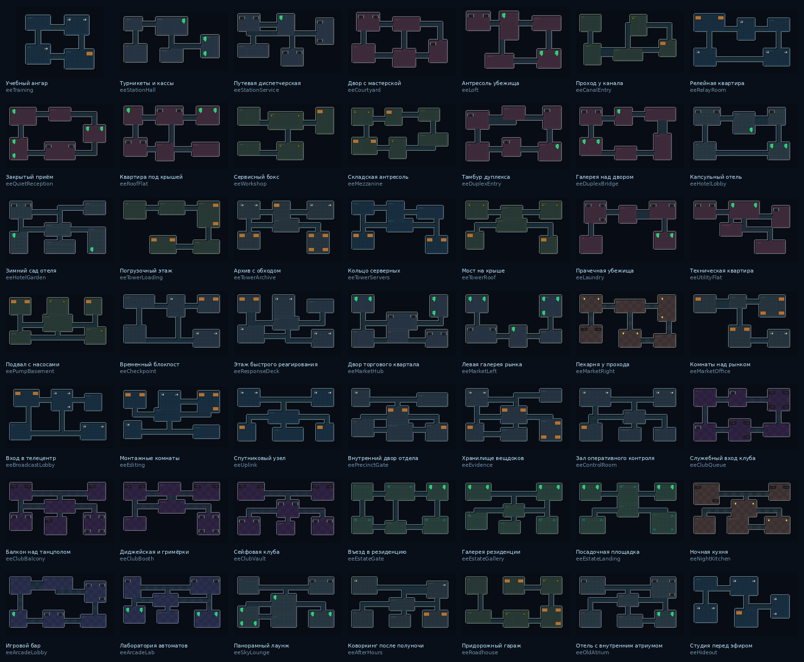

# Новые планировки

Все 48 игровых сцен и фон меню спроектированы для этой версии. Геометрия прежних карт заменена; идентификаторы новых сцен начинаются с `ee`. Игровые спрайты персонажей и предметов сохранены.

Планировки заданы отдельно в `tools/level-designs.mjs`: прямоугольные зоны в клетках по 32 пикселя и граф проходов. `node tools/create-levels.mjs` пересоздаёт JSON в `assets/rooms/` и обновляет манифест. Генератор не читает старые карты. Во время игры используются готовые JSON.

У каждой сцены собственный контур помещений. Проверка сравнивает формы с учётом поворотов и отражений и ищет доступный путь от входа к каждому противнику, оружию и выходу. Область каждого прохода остаётся свободной от мебели.

| Глава | Сцена | Название | Оформление |
|---|---|---|---|
| 00 | eeTraining | Учебный ангар | studio |
| 01 | eeStationHall | Турникеты и кассы | station |
| 01 | eeStationService | Путевая диспетчерская | station |
| 02 | eeCourtyard | Двор с мастерской | residential |
| 02 | eeLoft | Антресоль убежища | residential |
| 03 | eeCanalEntry | Проход у канала | industrial |
| 03 | eeRelayRoom | Релейная квартира | studio |
| 04 | eeQuietReception | Закрытый приём | residential |
| 04 | eeRoofFlat | Квартира под крышей | residential |
| 05 | eeWorkshop | Сервисный бокс | industrial |
| 05 | eeMezzanine | Складская антресоль | industrial |
| 06 | eeDuplexEntry | Тамбур дуплекса | residential |
| 06 | eeDuplexBridge | Галерея над двором | residential |
| 07 | eeHotelLobby | Капсульный отель | hotel |
| 07 | eeHotelGarden | Зимний сад отеля | hotel |
| 08 | eeTowerLoading | Погрузочный этаж | industrial |
| 08 | eeTowerArchive | Архив с обходом | office |
| 08 | eeTowerServers | Кольцо серверных | studio |
| 08 | eeTowerRoof | Мост на крыше | industrial |
| 09 | eeLaundry | Прачечная убежища | residential |
| 09 | eeUtilityFlat | Техническая квартира | residential |
| 09 | eePumpBasement | Подвал с насосами | industrial |
| 10 | eeCheckpoint | Временный блокпост | security |
| 10 | eeResponseDeck | Этаж быстрого реагирования | security |
| 11 | eeMarketHub | Двор торгового квартала | station |
| 11 | eeMarketLeft | Левая галерея рынка | station |
| 11 | eeMarketRight | Пекарня у прохода | food |
| 11 | eeMarketOffice | Комнаты над рынком | office |
| 12 | eeBroadcastLobby | Вход в телецентр | studio |
| 12 | eeEditing | Монтажные комнаты | studio |
| 12 | eeUplink | Спутниковый узел | studio |
| 13 | eePrecinctGate | Внутренний двор отдела | security |
| 13 | eeEvidence | Хранилище вещдоков | security |
| 13 | eeControlRoom | Зал оперативного контроля | security |
| 14 | eeClubQueue | Служебный вход клуба | club |
| 14 | eeClubBalcony | Балкон над танцполом | club |
| 14 | eeClubBooth | Диджейская и гримёрки | club |
| 14 | eeClubVault | Сейфовая клуба | club |
| 15 | eeEstateGate | Въезд в резиденцию | garden |
| 15 | eeEstateGallery | Галерея резиденции | garden |
| 15 | eeEstateLanding | Посадочная площадка | garden |
| 16 | eeNightKitchen | Ночная кухня | food |
| 17 | eeArcadeLobby | Игровой бар | arcade |
| 17 | eeArcadeLab | Лаборатория автоматов | arcade |
| 18 | eeSkyLounge | Панорамный лаунж | hotel |
| 19 | eeAfterHours | Коворкинг после полуночи | office |
| 20 | eeRoadhouse | Придорожный гараж | industrial |
| 21 | eeOldAtrium | Отель с внутренним атриумом | hotel |
| Меню | eeHideout | Студия перед эфиром | studio |
